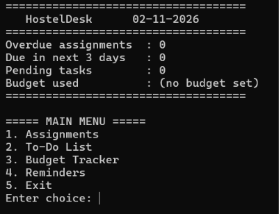
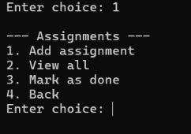
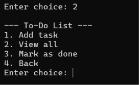
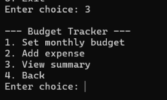
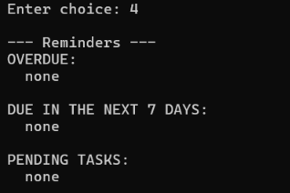

# StaySorted

StaySorted is a menu-driven C console application for hostel students to organize assignments, everyday tasks, and personal spending.

## Features

- Add and view assignments with subjects, titles, and due dates.
- Mark assignments as complete.
- Add and view to-do tasks, then mark them as done.
- Set a monthly budget and record expenses.
- View a budget summary.
- View reminders for overdue assignments, upcoming deadlines, and pending tasks.
- Save information locally between runs.

> Reminders appear inside the program when you open it or choose the reminders option. They are not phone or desktop notifications.

## Screenshots

### Main Menu


### Assignments


### To-Do List


### Budget Tracker


### Reminders


## Requirements

- GCC or another C compiler that supports C99
- A terminal on Windows, macOS, or Linux

## Compile and run

Open a terminal in the folder containing `hosteldesk_neat.c`.

### Windows PowerShell

```powershell
gcc -std=c99 -Wall -Wextra hosteldesk_neat.c -o hosteldesk_neat.exe
.\hosteldesk_neat.exe
```

### macOS or Linux

```bash
gcc -std=c99 -Wall -Wextra hosteldesk_neat.c -o hosteldesk_neat
./hosteldesk_neat
```

## C concepts demonstrated

- Structures and arrays
- Functions
- Loops and conditional statements
- Strings and input handling
- File handling
- Date and time handling

## Notes

- StaySorted is a local, single-user console program. It does not sync data between devices.
- Keep the program's generated data files if you want to retain your information.
- Avoid uploading personal assignment or spending data to a public repository.

## License

No license has been added. Add a `LICENSE` file if you want to specify how others may use or modify this project.
